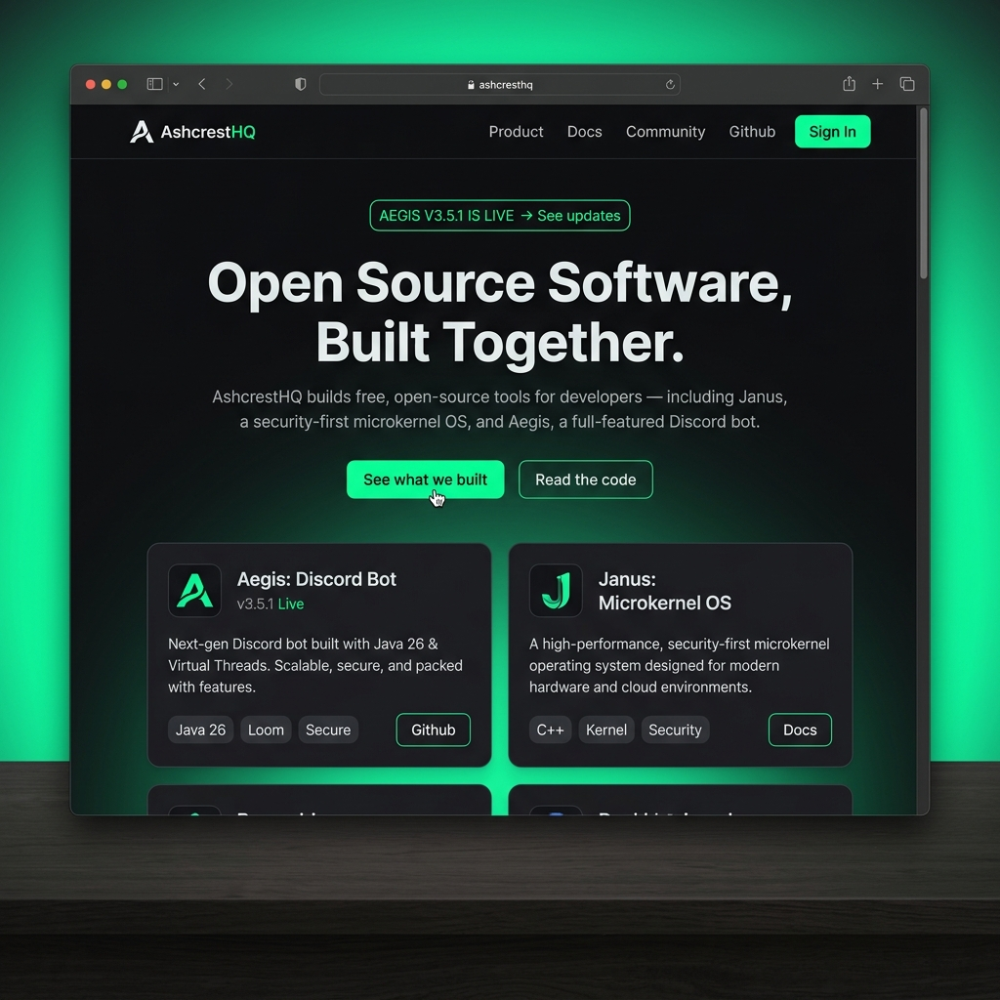
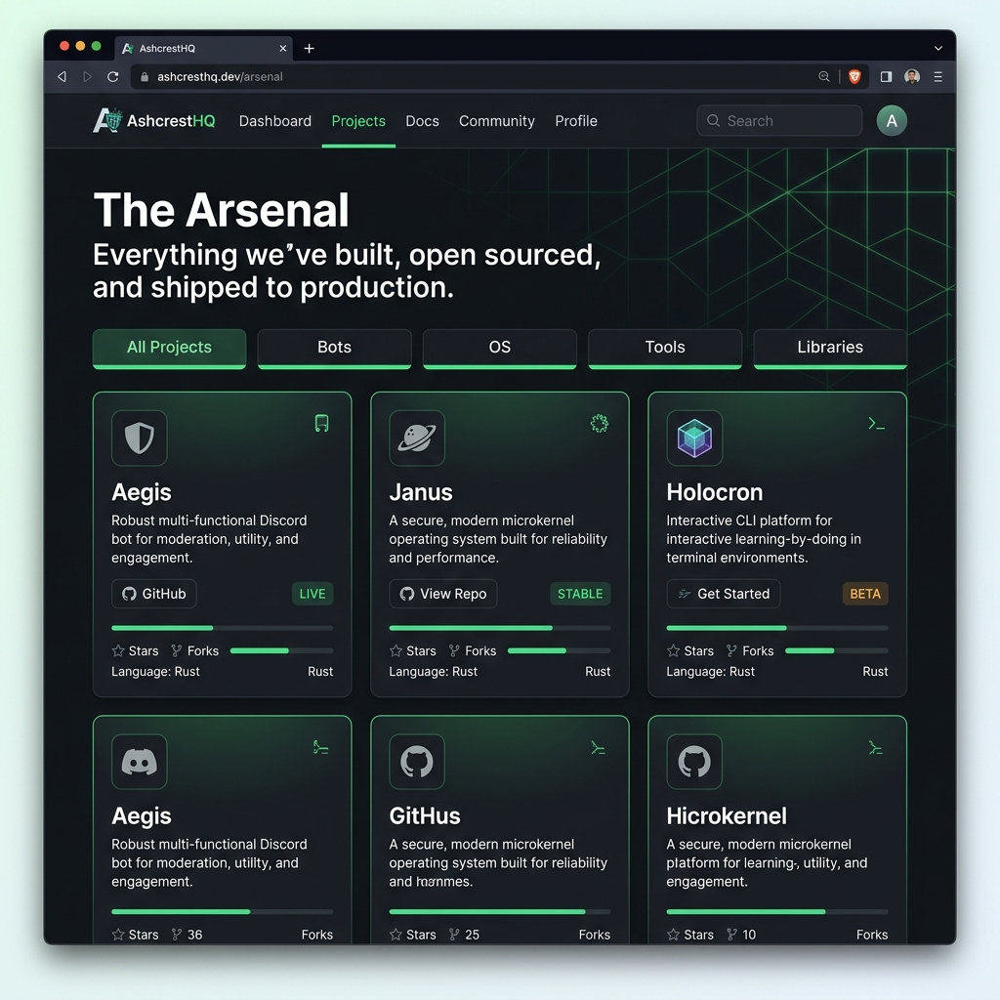
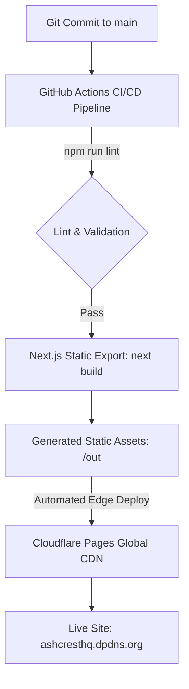

# AshcrestHQ Official Website

[](https://github.com/AshcrestHQ/ashcresthq-site/actions/workflows/ci.yml)
[](LICENSE)
[](https://ashcresthq.dpdns.org)
[](https://discord.gg/35ubQnrzD)

This repository powers the official **[AshcrestHQ](https://ashcresthq.dpdns.org)** website.

---

## 💡 What is AshcrestHQ?

**AshcrestHQ** is an independent, distributed open-source collective building high-performance developer tools, security-first microkernels, infrastructure software, and interactive learning platforms. 

We believe in radical transparency: **everything we build is public, open-source, and free from day one.** Whether you are shipping low-level systems code or building modern web applications, AshcrestHQ provides the tools and community to build together.

🌐 **Official Website**: [ashcresthq.dpdns.org](https://ashcresthq.dpdns.org)  
🐙 **GitHub Organization**: [github.com/AshcrestHQ](https://github.com/AshcrestHQ)  
💬 **Discord Community**: [Join the Discord Server](https://discord.gg/35ubQnrzD)

---

## ⚡ Flagship Projects

AshcrestHQ maintains a ecosystem of open-source projects across operating systems, Discord automation, and interactive education:

| Project | Category | Tech Stack | Description | Repository |
| :--- | :--- | :--- | :--- | :--- |
| **Janus** | Microkernel OS | C / Rust / TypeScript | A security-first microkernel operating environment designed for high-availability distributed nodes. | [AshcrestHQ/janus](https://github.com/AshcrestHQ/janus) |
| **Aegis** | Discord Bot | Java 26 / PostgreSQL / gRPC | High-performance Discord moderation bot powered by Virtual Threads for zero-latency server management. | [AshcrestHQ/Aegis](https://github.com/AshcrestHQ/Aegis) |
| **Holocron** | Developer Tools | Python CLI | Interactive learn-by-doing CLI teaching security fundamentals and open-source contribution workflows. | [AshcrestHQ/Holocron](https://github.com/AshcrestHQ/Holocron) |

---

## 📸 Visual Previews

### Homepage & Hero Section


### The Arsenal (Projects Showcase)


---

## 🛠️ Tech Stack & GitHub Topics

### Framework & Technologies
- **Framework**: [Next.js 16](https://nextjs.org/) (App Router & React 19)
- **Language**: [TypeScript](https://www.typescriptlang.org/)
- **Styling**: [Tailwind CSS v4](https://tailwindcss.com/) & Organic Glassmorphism
- **Animations**: [Framer Motion 12](https://www.framer.com/motion/) & [Three.js / React Three Fiber](https://threejs.org/)
- **Icons**: [Lucide React](https://lucide.dev/)
- **Deployment**: [Cloudflare Pages](https://pages.cloudflare.com/) (Static Export via `output: 'export'`)

### Repository Topics
`nextjs` • `typescript` • `tailwindcss` • `framer-motion` • `portfolio` • `open-source`

---

## 🏗️ Architecture & Cloudflare Deployment

The AshcrestHQ website is architected as an optimized, static single-page web app built via Next.js and deployed to Cloudflare's global edge network.



### Architecture Highlights
1. **Static Export (`output: 'export'`)**: Configured in `next.config.ts`, generating pure HTML, CSS, and JS bundles inside the `out/` directory.
2. **Client-Side GitHub API Fetching**: The projects showcase fetches live repository updates dynamically with caching fallback to minimize API rate limits.
3. **Edge Optimization**: Cloudflare Pages delivers instant global response times with zero server-side runtime overhead.

---

## 💻 Local Development Instructions

### Prerequisites
- **Node.js**: `v20.x` or higher
- **npm**: `v10.x` or higher

### 1. Clone & Install
```bash
git clone https://github.com/AshcrestHQ/ashcresthq-site.git
cd ashcresthq-site
npm install
```

### 2. Run Development Server
```bash
npm run dev
```
Open [http://localhost:3000](http://localhost:3000) in your browser to view the application.

### 3. Lint Code
```bash
npm run lint
```

### 4. Build Static Production Bundle
```bash
npm run build
```
The compiled static build will be placed in the `out/` directory.

---

## 🌍 Environment Variables

Environment variables are optional for local development, but can be configured in a `.env.local` file:

| Variable | Type | Default | Description |
| :--- | :--- | :--- | :--- |
| `NEXT_PUBLIC_SITE_URL` | Optional | `https://ashcresthq.dpdns.org` | Base URL used for open-graph metadata and canonical links. |
| `GITHUB_TOKEN` | Optional | *None* | GitHub Personal Access Token to elevate rate limits during repository metadata fetches. |

---

## 🚀 Deployment Instructions

### Cloudflare Pages Dashboard (Recommended)
1. Log into **Cloudflare Dashboard** -> **Workers & Pages**.
2. Click **Create application** -> **Pages** -> **Connect to Git**.
3. Select the `AshcrestHQ/ashcresthq-site` repository.
4. Configure build settings:
   - **Framework preset**: `Next.js`
   - **Build command**: `npm run build`
   - **Build output directory**: `out`
   - **Node.js Version**: `20.x`
5. Click **Save and Deploy**.

### Manual Deployment via Wrangler CLI
```bash
# Build the static output
npm run build

# Deploy output directory directly to Cloudflare Pages
npx wrangler pages deploy out --project-name ashcresthq-site
```

---

## 📊 Deployment & Live Status

| Environment | Platform | Status | URL |
| :--- | :--- | :--- | :--- |
| **Production** | Cloudflare Pages |  | [ashcresthq.dpdns.org](https://ashcresthq.dpdns.org) |
| **Continuous Integration** | GitHub Actions |  | [Actions Runs](https://github.com/AshcrestHQ/ashcresthq-site/actions) |

---

## 🤝 Contributing

We welcome contributions of all sizes! Please review our [CONTRIBUTING.md](CONTRIBUTING.md) guide for details on submitting pull requests, coding standards, and reporting issues.

Please also review our [Code of Conduct](CODE_OF_CONDUCT.md) before joining community discussions.

---

## 📜 Release History & Licensing

- Refer to [CHANGELOG.md](CHANGELOG.md) for full release history and updates.
- Distributed under the **MIT License**. See [LICENSE](LICENSE) for details.
